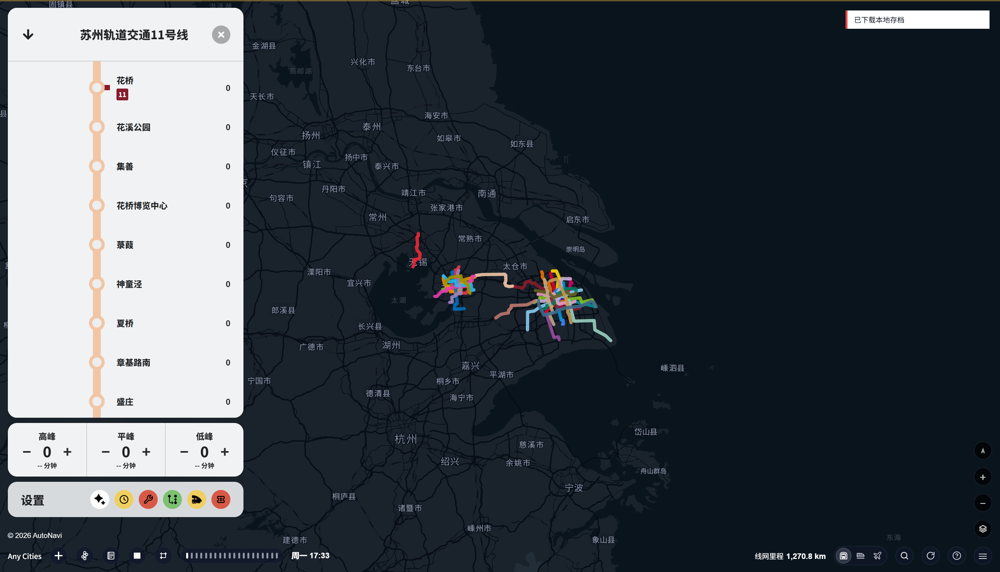
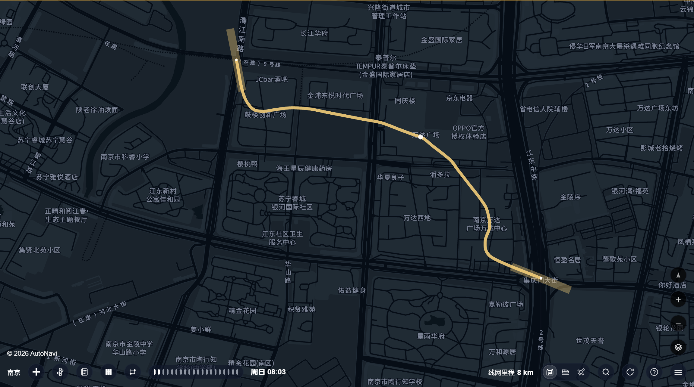
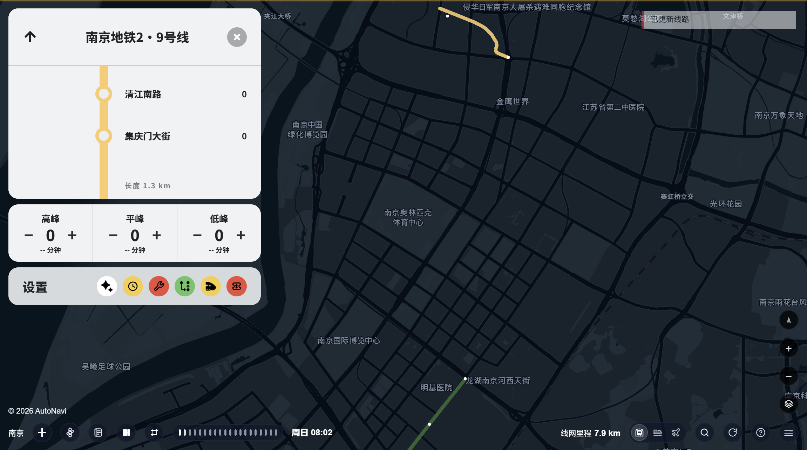

# city-metro-builder · 地铁绘制与全自动经营托管技能

`beta1.0`

在 [Cities Designers](https://www.citiesdesigners.com)（城市设计师·地铁模拟）里，用**游戏官方接口**绘制地铁线路、按规划图复刻线网、并全自动托管经营。本仓库是一个 Agent Skill：加载即用的指南（`SKILL.md`）+ 可注入工具箱（`scripts/funcs/`）+ 离线图像管线（`scripts/plan-map.py`）+ 回归测试（`_dev/`）。

## 下载

[GitHub Releases](https://github.com/ayst-z/city-metro-builder/releases) 提供 **纯净整合包 ZIP**（`city-metro-builder-beta1.0-oss.zip`，解压即为技能目录，不含赞赏码）。仓库本体含赞赏码（见文末），发行包不含。

## 界面预览

> 截图为游戏真实渲染（深色主题 · 高德底图），仅展示功能，不含个人存档/账号信息。

| 多城市线网（上海+苏州+无锡）与线路信息面板 | 规划图复刻线路（平滑贴合走廊） |
| --- | --- |
|  |  |

官方线路属性面板（名称/标识色/车型/编组/限速）：



## 功能总览

| 模块 | 注入对象 | 职责 |
|---|---|---|
| MT·core | `__metroToolkit` | 坐标/城市/规格/配色/POI 校验/超时降级 |
| MT·node | 同上 | 几何权威：样条/曲率抽稀/站台避让 |
| MT·amap | 同上 | 数据源：高德 srhdata/POI/SUBWAY/OSM/有轨/瓦片 |
| OD | `__officialDraw` | 官方绘制/检查/支线/环线/换乘 |
| K | `CityMetroKit` | 批量/快照回滚/风险拦截/命名/地区 |
| Ops | `MetroOps` | 客流/排班/票价/收益 |
| OE | `OfficialEdit` | 经营编辑/额度递增报价/监测/官方建延支 |
| FareLab | `FareLab` | 票价对照实验 |
| PlanMap | `PlanMap` | 规划图复刻（图纸→几何→官方绘制） |
| Autopilot | `MetroAutopilot` | 全自动经营托管（自递归+AI 分析升级） |
| Modes | `CityTransportModes` 等 | 高铁/航空多模式预留 |

## 官方绘线

核心五步：询问名称→查询数据→官方绘制→四检→汇报确认。`OD.drawLine` 逐站官方 place 绘制；`applyLineData` 数据统一写入（环线 N 段含闭合段）；`setLineProps` 设色/车型/编组/限速。支线走官方 `startBranchLine`（`startBranch→applyBranchData→setBranchAnchors→finishBranch`，选最长支为主）；环线 `completeRingLine` 闭合。延长走官方 `startExtendLine`，不拆独立线。

## 数据源与坐标

`MT.queryLine` 降级链：srhdata→游戏内高德→免费 Web→POI→OSM；返回 `pathQuality/needsPath` 标记直线需精化。默认高德；OSM 引擎先取高德再 `toGameCoords` 转 WGS-84。**坐标基准=该线自己的 SUBWAY path**（`queryLinePaths`+投影，站骑本线 dev≈0），不用通用 POI 当基准。`resolveCoordTwice` 两次查询防错配；规划 POI 需正向线证据，拒出入口/铁路/公交。

## 节点几何（单一权威 MT）

`curvatureThin` 五步：DP 保形→弯道渐变加密→直线均匀化→minGap 过滤→全局间距平滑（插点距段终点≥minGap，防近重复点被游戏拒）。`fitSegmentNodes` 站投影+样条拟合+站台避让（返回密集段需再抽稀）。`padSegmentNodes`/applyLineData④b 统一剔除距两端站<100m 节点（环线/支线直写前必调）。`_chainRatio` 绕路比（环线1.3/普通2.2）。游戏用 Catmull-Rom 渲染，节点=控制点，宁疏合理但必须贴 path。

## 规划图复刻（客观第一）

图纸只作大致参考（站名/站序/颜色/走廊），**几何结合真实地理自主设计**；像素拟合保留为弱模型备选。`plan-map.py`：`fit_transform`（≥3 不共线锚点+≥2 独立验点，SVD 仿射≤250m，凸包禁外推）+ `trace_segment`（Lab 色带+距离变换+A*+via，覆盖≥65%，无直线兜底）+ `chaikin` 去栅格阶梯。`PlanMap.prepare(compiled,i,real)` 几何现实优先（真实节点>真实 path>图纸平滑链）；`draw` 仅隔离创意普通线、官方逐步；`check` 写回≤2m/避让/站序。道路走廊综合校验（Walking/Driving 比对，中位≤40m 才吸附）。

## 检查与校验

`OD.checkLine3x` 四检（结构/坐标/视觉/走向）；`hasNodeOrderIssue/fixNodeOrder` 节点乱序（折返>120°/中点偏>500m）；`PlanMap.check` 站序/节点/色/spec/避让/pending。改前 `K.snapshot`，可 `rollback`；RED 风险未确认不执行。

## 经营运营

`Ops.recommendFares` **经营模式默认官方五段 1/2/3/4/5**（边界0/6/12/22/32/∞，对齐成本带/补贴=利润最优）；创意小网络才用需求弹性。`recommendSchedule/applySchedule` 逐交路、无样本保留服务；`applyExpress/applyShortTurn` 额度内。`OE.economyPlan` 额度缺口+递增报价+日结预留（usable=balance-dailyReserve）；`startQuotaBuyLoop` 只用余额、达标停。`FareLab` 票价对照实验。

## 全自动经营托管（Autopilot）

仅经营模式。`start({intervalMs,maxTicks,buyPacks,dryRun,optimizeOperations,analysisEvery})` 有界循环：官方五段票价→逐交路排班(保守上限)→额度内快车/小交路→递增购配额(留日结)→官方恢复→区间营收复核→日志。**自递归优化** `optimizeCycle`：测量→adaptStrategy(改进放宽/劣化收缩,爬山+收敛)→递归，受 LIMITS 安全边界。**AI 分析升级**：营收劣化/客流未加载/连续劣化/周期巡检→pendingAnalysis+onAnalysis 通知宿主 spawn 智能体→`resolveAnalysis` 回写(受边界)恢复。不存档/不抢前台/不绕配额。

## 怎么用

拷贝本目录到 agent skills 目录；或按序注入：`mt-core → mt-node → mt-amap → od → k →（可选）ops/autopilot/official-edit/fare-lab/modes/plan-map`。示例：
```js
const r = await MT.queryLine('上海','17',{stationFrom:'西岑',stationTo:'虹桥火车站'});
await OD.drawLine(lineId, r.stations, r.nodes, {});
OD.checkLine3x(lineId,{strict:'strict'});
MetroAutopilot.start({intervalMs:60000,maxTicks:240,analysisEvery:10});
```

## 自检 / 测试

`_dev/`：test-plan-map.py(10) / test-plan-poi.js(17) / test-plan-draw.js(45) / test-autopilot.js(11) / test-branch-ring.js(3) / smoke.js / lint-static.js。改几何必跑全量。

## 目录

```
SKILL.md            主指南（全局硬规则/板块/函数速查）
references/         专题：api-reference(全量函数)/plan-map-draw/metro-planning-principles/operations/…
scripts/funcs/      注入工具箱（query/draw/manage/ops/modes）
scripts/plan-map.py 离线配准+追线
_dev/               回归测试
docs/               THIRD_PARTY / 赞赏码
```

## 隐私与许可

不含个人存档/本机路径/密钥/城市站表/版权规划图；发行包纯净。MIT（LICENSE）；数据与算法来源见 docs/THIRD_PARTY.md（高德/OSM 数据遵循提供方条款，坐标转换/样条/DP/Chaikin/A* 为公共算法原创实现）。

## 反馈与支持

如果这个项目对你有帮助，欢迎扫码赞赏（卧龙凤雏 的赞赏码）：


## 许可证

MIT
