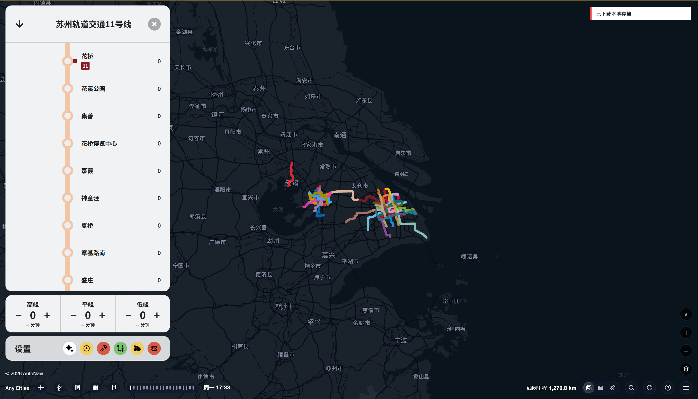
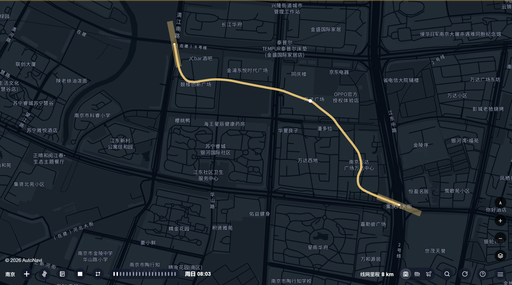
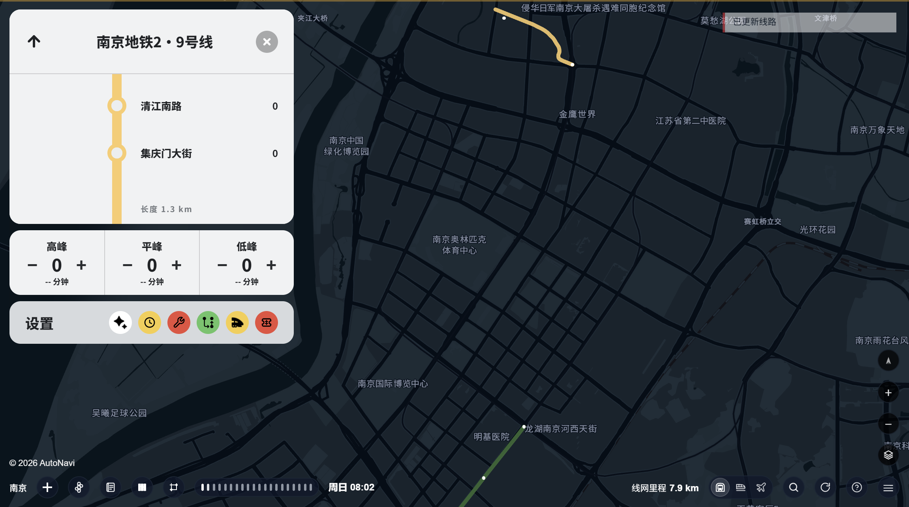

# city-metro-builder · 地铁绘制与全自动经营托管技能

`beta1.3`（2026-11-15 已发布；页面自检工具沿用 beta2 命名）

在 [Cities Designers](https://www.citiesdesigners.com)（城市设计师·地铁模拟）里，用**游戏官方接口**绘制地铁线路、按规划图复刻线网、并全自动托管经营。本仓库是一个 Agent Skill：加载即用的指南（`SKILL.md`）+ 可注入工具箱（`scripts/funcs/`）+ 离线图像管线（`scripts/plan-map.py`）+ 回归测试（`_dev/`）；所有线路数据可查询、可检查、可回滚。

## 下载

`city-metro-builder-beta1.3-oss.zip` 已随 [beta1.3 Release](https://github.com/ayst-z/city-metro-builder/releases/tag/beta1.3) 发布；zip 的 size/sha256 记录在仓库根 `README.md`（包内不写自引用数字）。已发布的历史版本 `beta1.2` 仍保留在 [GitHub Releases](https://github.com/ayst-z/city-metro-builder/releases)。此前未发布的 beta2 本地 zip 只是本过程的历史中间件（非正式版，已被 beta1.3 取代），不随本包发布；解压 zip 即为技能目录，不含赞赏码。仓库本体含赞赏码（见文末），发行包不含。

## 界面预览

> 截图为游戏真实渲染（深色主题 · 高德底图），仅展示功能，不含个人存档/账号信息。

| 多城市线网（上海+苏州+无锡）与线路信息面板 | 规划图复刻线路（平滑贴合走廊） |
| --- | --- |
|  |  |

官方线路属性面板（名称/标识色/车型/编组/限速）：



## 功能总览

| 模块 | 注入对象 | 职责 |
|---|---|---|
| MT·core | `__metroToolkit` | 坐标/城市/规格/配色/POI 校验/超时降级 |
| MT·node | 同上 | 几何权威：样条/曲率抽稀/站台避让 |
| MT·amap | 同上 | 数据源：高德 srhdata/POI/SUBWAY/OSM/有轨/瓦片 |
| OD | `__officialDraw` | 官方绘制/检查/支线/环线/换乘 |
| K | `CityMetroKit` | 批量/快照回滚/风险拦截/命名/地区 |
| Ops | `MetroOps` | 客流/排班/票价/收益 |
| OE | `OfficialEdit` | 经营编辑/额度递增报价/监测/官方建延支 |
| FareLab | `FareLab` | 票价对照实验 |
| PlanMap | `PlanMap` | 规划图复刻（图纸→几何→官方绘制） |
| Autopilot | `MetroAutopilot` | 全自动经营托管（自递归+AI 分析升级） |
| Modes | `CityTransportModes` 等 | 高铁/航空多模式预留 |

## 文档

| 文档 | 内容 |
|---|---|
| [docs/GUIDE.md](docs/GUIDE.md) | 快速开始（CDP 前置/一次注入/查询/绘制/四检/回滚）+ 架构（分层/数据流/不变量/扩展点）+ 13 条排障 |
| [docs/PRIVACY.md](docs/PRIVACY.md) | 隐私审核范围、结论与数据合规 |
| [docs/THIRD_PARTY.md](docs/THIRD_PARTY.md) | 第三方数据与算法来源 |
| [references/](references/) | 专题：api-reference（全量函数）/ official-draw / operations / plan-map-draw / beta2-acceptance … |

## 官方绘线

核心五步：询问名称→查询数据→官方绘制→四检→汇报确认。`OD.drawLine` 逐站官方 place 绘制；`applyLineData` 数据统一写入（环线 N 段含闭合段）；`setLineProps` 设色/车型/编组/限速。支线走官方 `startBranchLine`（`startBranch→applyBranchData→setBranchAnchors→finishBranch`，选最长支为主）；环线 `completeRingLine` 闭合。延长走官方 `startExtendLine`，不拆独立线。

## 数据源与坐标

`MT.queryLine` 降级链：srhdata→游戏内高德→免费 Web→POI→OSM；返回 `pathQuality/needsPath` 标记直线需精化。默认高德；OSM 引擎先取高德再 `toGameCoords` 转 WGS-84。**坐标基准=该线自己的 SUBWAY path**（`queryLinePaths`+投影，站骑本线 dev≈0），不用通用 POI 当基准。`resolveCoordTwice` 两次查询防错配；规划 POI 需正向线证据，拒出入口/铁路/公交。

## 节点几何（单一权威 MT）

`curvatureThin` 五步：DP 保形→弯道渐变加密→直线均匀化→minGap 过滤→全局间距平滑（插点距段终点≥minGap，防近重复点被游戏拒）。`fitSegmentNodes` 站投影+样条拟合+站台避让（返回密集段需再抽稀）。`padSegmentNodes`/applyLineData④b 统一剔除距两端站<100m 节点（环线/支线直写前必调）。`_chainRatio` 绕路比（环线1.3/普通2.2）。游戏用 Catmull-Rom 渲染，节点=控制点，宁疏合理但必须贴 path。

## 规划图复刻（客观第一）

图纸只作大致参考（站名/站序/颜色/走廊），**几何结合真实地理自主设计**；像素拟合保留为弱模型备选。`plan-map.py`：`fit_transform`（≥3 不共线锚点+≥2 独立验点，SVD 仿射≤250m，凸包禁外推）+ `trace_segment`（Lab 色带+距离变换+A*+via，覆盖≥65%，无直线兜底）+ `chaikin` 去栅格阶梯。`PlanMap.prepare(compiled,i,real)` 几何现实优先（真实节点>真实 path>图纸平滑链）；`draw` 仅隔离创意普通线、官方逐步；`check` 写回≤2m/避让/站序。道路走廊综合校验（Walking/Driving 比对，中位≤40m 才吸附）。

## 检查与校验

`OD.checkLine3x` 四检（结构/坐标/视觉/走向）；`hasNodeOrderIssue/fixNodeOrder` 节点乱序（折返>120°/中点偏>500m）；`PlanMap.check` 站序/节点/色/spec/避让/pending。改前 `K.snapshot`，可 `rollback`；RED 风险未确认不执行。

## 经营运营

`Ops.recommendFares` **经营模式默认官方五段 1/2/3/4/5**（边界0/6/12/22/32/∞，对齐成本带/补贴=利润最优）；创意小网络才用需求弹性。`recommendSchedule/applySchedule` 逐交路、无样本保留服务；`applyExpress/applyShortTurn` 额度内。`OE.economyPlan` 额度缺口+递增报价+日结预留（usable=balance-dailyReserve）；`startQuotaBuyLoop` 只用余额、达标停。`FareLab` 票价对照实验。

## 全自动经营托管（Autopilot）

仅经营模式。`start({intervalMs,maxTicks,buyPacks,dryRun,optimizeOperations,analysisEvery})` 有界循环：官方五段票价→逐交路排班(保守上限)→额度内快车/小交路→递增购配额(留日结)→官方恢复→区间营收复核→日志。**自递归优化** `optimizeCycle`：测量→adaptStrategy(改进放宽/劣化收缩,爬山+收敛)→递归，受 LIMITS 安全边界。**AI 分析升级**：营收劣化/客流未加载/连续劣化/周期巡检→pendingAnalysis+onAnalysis 通知宿主 spawn 智能体→`resolveAnalysis` 回写(受边界)恢复。不存档/不抢前台/不绕配额。

## 怎么用

把 zip 解压到宿主的 agent skills 目录，目录名保持 `city-metro-builder`；也可直接使用工作区的 `skills/city-metro-builder`。

**一次注入（推荐）**：`scripts/inject-toolbox.js` 按稳定依赖顺序幂等装好 **13 个核心模块**（5 必需 + 8 可选），并打印逐模块结果、版本表、缺失/版本不符报告：

```bash
node <skill-root>/scripts/inject-toolbox.js --cdp <cdp-host>:<port>
```

- 需要 CDP 控制服务（`POST /script` / `POST /eval`）。浏览器桥在**完整仓库**的 `browser/cdp.mjs`，**发行 zip 不含桥**；没有兼容桥时不要硬试，按 `SKILL.md` §2.4 手动逐个注入，效果等价，只是没有版本表与自动中止。
- 退出码：`0` 全绿 / `2` 可选模块降级 / `1` 失败或中止 / `64` 用法错误。缺必需文件、页面版本比期望更新（默认不降级）会在注入前失败；必需模块失败即中止并报 `partial=true`。

**手动注入顺序（13 个核心模块，不可乱）**：

`mt-core → mt-node → mt-amap → od → k → plan-map → ops → official-edit → fare-lab → autopilot → mode-registry → hsr-probe → air-probe`

`metro-unopened-paths.js`（未开通线瓦片）与 srhdata 数据**不在这 13 个之内**，按需单独注入。

示例：

```js
const r = await MT.queryLine('上海','17',{stationFrom:'西岑',stationTo:'虹桥火车站'});
await OD.drawLine(lineId, r.stations, r.nodes, {});
OD.checkLine3x(lineId,{strict:'strict'});
MetroAutopilot.start({intervalMs:60000,maxTicks:240,analysisEvery:10});
```

## 自检 / 测试

`_dev/`：test-plan-map.py(10) / test-plan-poi.js(17) / test-plan-draw.js(45) / test-autopilot.js(12) / test-branch-ring.js(3) / smoke.js / lint-static.js。改几何必跑全量。

```powershell
node _dev/run-all.mjs   # 一条命令顺序跑 7 组，逐项 PASS/FAIL + 汇总，失败/超时非 0 退出
```

单组默认超时 180s，可用 `--timeout <ms>` 覆盖。页面侧另有 `scripts/beta2-selfcheck.js`（`__beta2SelfCheck()` 只读 19 项、`{live:true}` 只读换乘审计+状态恢复、`__beta2SelfCheckText()` 人类可读报告）与 `scripts/transfer-coords.js`（换乘坐标审计/修复）。验收口径见 `references/beta2-acceptance.md`。

## 目录

```
SKILL.md                    主指南（全局硬规则/板块/函数速查）
references/                 专题：api-reference / plan-map-draw / metro-planning-principles / operations / beta2-acceptance …
scripts/funcs/              注入工具箱（query/draw/manage/ops/modes）
scripts/inject-toolbox.js   一次注入编排（13 核心模块，幂等 + 版本表/缺失报告）
scripts/beta2-selfcheck.js  页面只读自检 + live 只读往返 + 文本报告
scripts/transfer-coords.js  换乘站坐标审计/修复（本线 path 投影）
scripts/plan-map.py         离线配准 + 追线
_dev/run-all.mjs            7 组离线回归一键入口（逐项 PASS/FAIL）
_dev/                       其余单组测试
docs/                       本文档集 / 截图 / 第三方声明
```

## 更新日志

### beta1.3（2026-11-15，已发布；内部自检工具仍名 beta2）

- **一次注入**：`scripts/inject-toolbox.js` 按稳定依赖顺序幂等装 13 个核心模块（5 必需 + 8 可选）；依赖顺序修正为 `ops → official-edit → fare-lab → autopilot`，`autopilot` 不再早于它依赖的 OE；缺文件/版本不符不半装，报告含逐模块结果与版本表。
- **统一测试入口**：`_dev/run-all.mjs` 一条命令跑 7 组，逐项 PASS/FAIL、失败/超时非 0 退出；Autopilot 回归 12 项。
- **自检可读报告**：`__beta2SelfCheckText()` / `__beta2SelfCheckReport(r)` 输出通过/失败/跳过、livePass、恢复与换乘审计摘要，不改变旧返回结构。
- **live 安全化（待实机复跑）**：live 改为可逆往返——记录暂停/速度，换乘只做**只读**审计，成功/异常都在 `finally` 恢复并报告恢复证据；不再依赖写接口来判定通过。本轮尚未实机复跑，验收记录标为待验证。
- **同步守卫**：`tools/check-sync.mjs` 校验真源↔安装副本、release.json↔SKILL/GUIDE 版本行、发行输入；构建前置预检，fresh clone/CI 需显式 `--skip-install-check`。
- **发行 zip 防覆盖**：同名 zip 默认拒绝覆盖，`--force` 才允许；临时文件校验通过后原子替换，失败清理临时文件、旧 zip 不受影响。

### beta1.2（2026-11-13）

- **结构整合**：发行产物不再入库，由 `tools/build-release.mjs` 生成到 `release/.build/`（Git 忽略）；仓库文件数约减半，源与产物不再三份并存
- **文档合并**：`QUICKSTART` + `ARCHITECTURE` + `FAQ` → 一篇 `docs/GUIDE.md`（上手 / 架构 / 排障）
- **打包校验**：生成后解包 zip 逐文件比对 SHA-256，防止产物与源漂移
- 技能代码与 beta1.1 一致（无逻辑改动）

### beta1.1（2026-11-13）

- **Autopilot 0.3.1**：营收劣化自动回滚（`captureConfig` 快照 + `rollback`），回归 12 项
- **OD 2.60.3**：几何去重——`_haversineM`/`localTurn`/`distM` 委托 MT，`_chainRatio` 合并 6 处绕路检测
- **文档**：`api-reference` 逐函数详解扩写；`update-2026-09-27`/`efficient-mode` 并入 `operations`，`metro-diagram` 并入 `ui-features`
- **发行包**：补齐 `scripts/funcs` 模块说明；与技能源逐文件一致（打包时校验）

### beta1.0（2026-11-10）

首个开源整合包：官方绘线 + 规划图复刻 + 经营运营 + MetroAutopilot 0.3.0 全自动托管。

## 反馈与支持

如果这个项目对你有帮助，欢迎扫码赞赏（卧龙凤雏 的赞赏码）：


## 隐私与许可

不含个人存档/本机路径/密钥/城市站表/版权规划图；发行包纯净。MIT（LICENSE）；数据与算法来源见 docs/THIRD_PARTY.md（高德/OSM 数据遵循提供方条款，坐标转换/样条/DP/Chaikin/A* 为公共算法原创实现）。

## 许可证

MIT
